

<a href="https://abuomar.dev">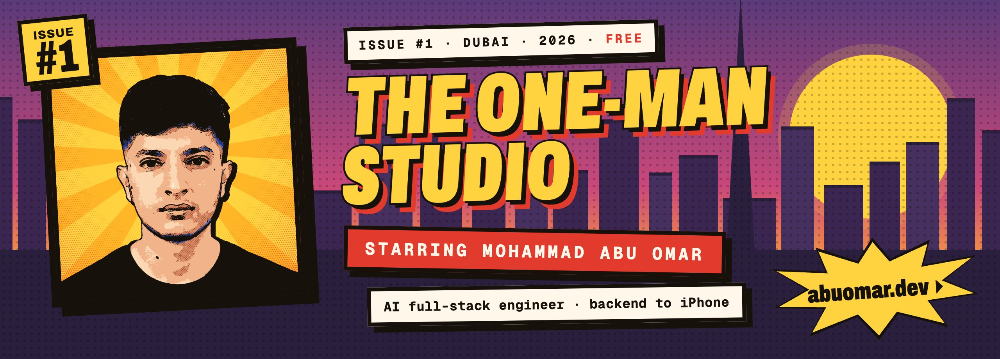</a>

<a href="https://abuomar.dev">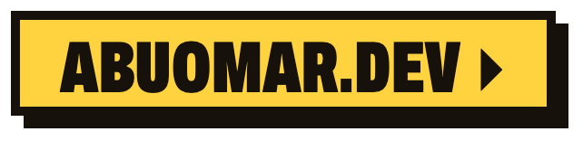</a>  <a href="mailto:mohamadamy44@gmail.com">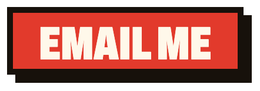</a> <a href="https://tweenui.dev">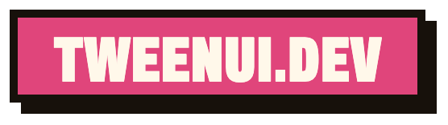</a>

 

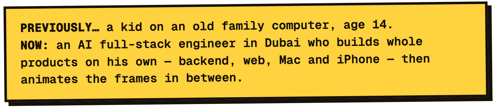

 

**[abuomar.dev](https://abuomar.dev)** — my portfolio is a 3D comic-book city at dusk. Scroll and the camera flies down the street; every building is one of my crafts, and every door opens a playable comic panel. Built with Next.js, React Three Fiber, a hand-written comic shader and GSAP — in English and Arabic.

<a href="https://abuomar.dev">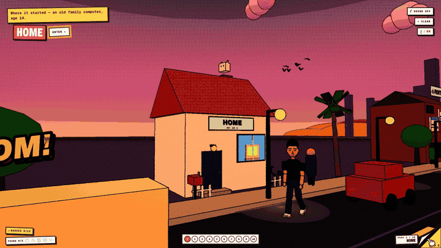</a>

 

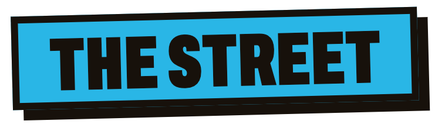

<a href="https://abuomar.dev">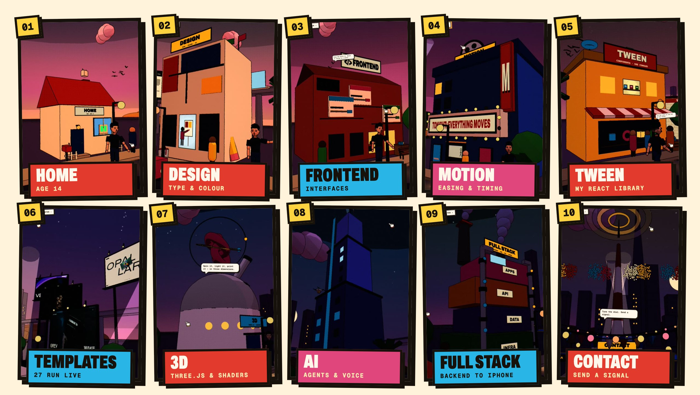</a>

 

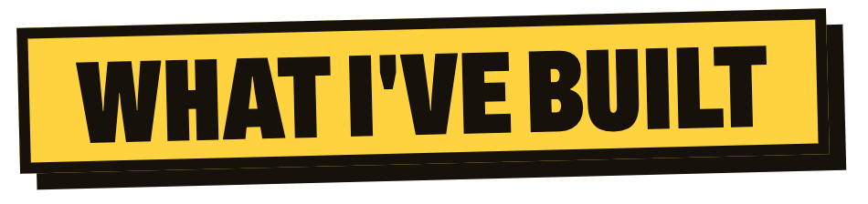

<table>
<tr>
<td width="50%" valign="top">

### OVO — ERP & Imagine
<b>Solo engineer · Jan 2026 — now · Dubai</b>

The only engineer at a fashion manufacturer making collections for 19+ brands. I built its **ERP end to end — 43 modules, 11,000+ commits** — and **Imagine**, its AI image and video studio: plain garment photos in, campaign images and multi-shot films out.

</td>
<td width="50%" valign="top">

### Storm
<b>Creator · sole engineer · 2026</b>

A team of AI bots that run a business's inbox, sales, invoices and reports. The bots have their **own email and phone number** and **1,400+ app connections** — on Mac, iPhone, web and cloud.

</td>
</tr>
<tr>
<td width="50%" valign="top">

### [Tween](https://tweenui.dev)
<b>Creator · maintainer · 2026 — now</b>

A live library of **138 animated React components** and full landing-page templates — Three.js, React Three Fiber, GSAP, Framer Motion — each one shadcn command to install.

</td>
<td width="50%" valign="top">

### [Billix](https://billix.io)
<b>Founder · AI engineer · 2025 — 2026</b>

An AI agent platform with **200+ models**: a desktop computer-use agent (Electron + a Rust sidecar), real-time voice mode, Deep Search, RAG and a workflow builder you drive with prompts.

</td>
</tr>
</table>

Before that: AI engineer at Rivalz Network (2024) · full-stack developer at Raydian (2023) · 15+ freelance web apps (2022) · first line of code at 14.

 

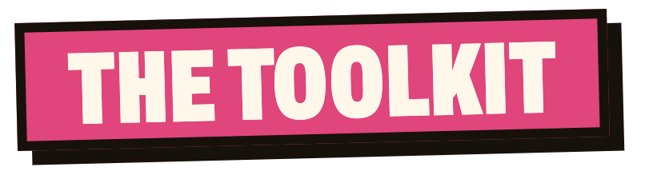

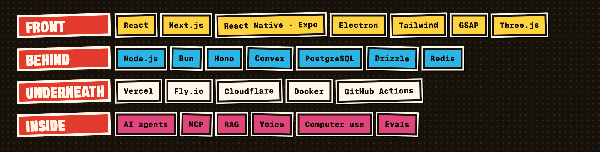

 

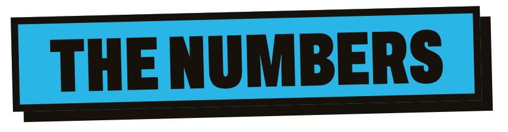


 

**Available now** · UAE residence visa · Dubai. If you've got something that needs to move, write to me.

  <a href="https://abuomar.dev/cv/mohammad-abu-omar-comic.pdf">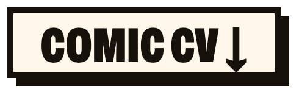</a> 

 

Issue #1 of <a href="https://abuomar.dev">The One-Man Studio</a> · drawn in Dubai · the numbers redraw themselves every day

